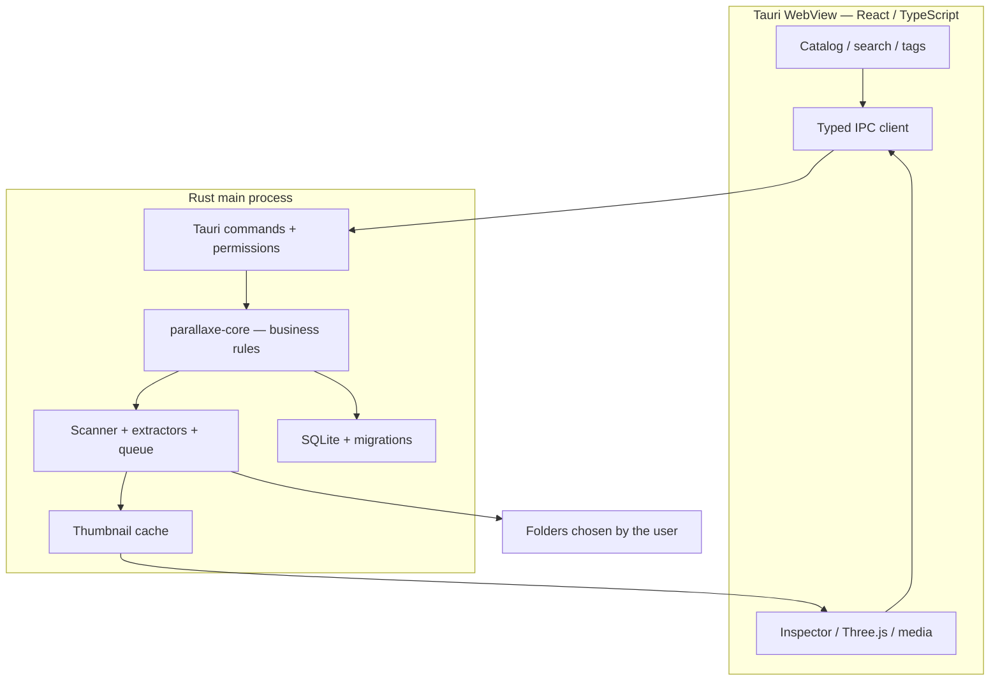

# Architecture

## Overview



The frontend never opens arbitrary system paths and never touches the SQLite file. It calls a controlled command interface. Long operations publish progress, completion, cancellation and errors without blocking the UI thread.

## Stack

| Layer | Choice |
|---|---|
| Shell | Tauri 2 |
| UI | React, TypeScript (strict), Vite |
| Styling | Tailwind CSS, plain CSS where it is clearer, Motion only when an animation is justified |
| Native core | Rust |
| Storage | SQLite (WAL, FTS5 for search) |
| 3D | Three.js — `GLTFLoader`, `OBJLoader` + `MTLLoader`, `STLLoader` |
| Package managers | pnpm, Cargo |

## Layer responsibilities

| Layer | Does | Does not |
|---|---|---|
| React | Navigation, rendering, input, async states, viewer control | Raw filesystem access, direct SQLite writes |
| TypeScript IPC client | Typed DTOs, error handling, Tauri commands | Enforce business permissions alone |
| Tauri commands | Authorization, validation, orchestration, progress channels | Heavy decoding on the main thread |
| `parallaxe-core` | Identities, tagging rules, transactions, use cases | Depend on Tauri or React |
| Indexer | Scan, enrichment, watcher, per-file errors | Delete sources or follow symlinks without a rule |
| Preview | Thumbnails, bounded access to authorized content | Serve arbitrary `file://` paths |
| Catalog | Persistence, indexed search, migrations | Write into source folders |
| 3D WebView | Three.js interaction and rendering | Run scripts shipped inside assets |

## Repository layout

A single monorepo ([ADR-0001](decisions/0001-monorepo.md)). Folders are created only when they contain real code.

```text
apps/desktop/              Tauri 2 + React app
  src/                     React UI
  src-tauri/               Rust shell, commands, capabilities
crates/parallaxe-core/     Business rules, no Tauri dependency
crates/…                   catalog, indexer, preview — extracted when boundaries are proven
crates/parallaxe-cli/      after the MVP
crates/parallaxe-mcp/      after the MVP
packages/shared-types/     TypeScript DTOs generated from Rust
skills/                    Agent Skill, after the MVP
tests/fixtures/            Redistributable corpus with SHA-256 manifest
docs/                      This site
```

## Data model (MVP)

| Table | Main fields |
|---|---|
| `libraries` | `id`, `name`, timestamps |
| `roots` | `id`, `library_id`, `path_native`, `status`, `last_seen_at` |
| `assets` | `id` (UUID), `library_id`, `root_id`, `path_native`, `filename`, `ext`, `kind`, `size_bytes`, `mtime`, `fs_identity?`, `status` |
| `asset_metadata` | `asset_id`, `schema_version`, `metadata_json`, `extraction_status` |
| `tags`, `asset_tags` | Tags unique per library (case-insensitive), N:N relation |
| `collections`, `collection_assets` | Virtual groups, N:N relation |
| `favorites` | `asset_id` |
| `previews` | `asset_id`, `content_version`, `cache_key`, `state`, `last_access` |
| `scan_jobs`, `scan_errors` | Progress, resume and sanitized error log |
| `asset_dependencies` | Explicit references only, with resolution status |

Search uses an FTS5 table on name and path. The WebView never runs SQL.

### Identity and paths

- Native path APIs (`PathBuf`, `OsString`); paths are never assumed to be UTF-8.
- Each asset has a stable local UUID as long as reconciliation confirms it is the same file.
- Matching order: persistent filesystem identity + root → existing path with matching properties → full hash **on demand** → user decision.
- `mtime + size` is never treated as proof of identity.
- Symlinks are not followed by default; nested roots are normalized to avoid double indexing.

### Integrity

`foreign_keys=ON`, transactions, WAL on local filesystems only, versioned transactional migrations with a backup before major ones. A failed migration never opens a half-migrated schema read-write. Caches are always rebuildable and never the only copy of business data.

## Indexing pipeline

1. The user picks a folder in the native dialog; Rust registers an **authorized root**.
2. Entries are streamed, never fully listed in memory; depth, loops and symlinks are bounded.
3. `stat` plus magic-byte detection, with the extension as a fallback.
4. Generic assets are upserted in batches; progress is published periodically.
5. Extractors run independently of the scan with bounded parallelism.
6. Metadata then thumbnails are produced in the app cache, keyed by asset ID and content version.
7. A final report counts indexed, unsupported, inaccessible, skipped and failed files.
8. Roots are watched while reachable; debounced events plus periodic or manual rescans, because watchers miss events.

Job priority: `user_preview` > `visible_thumbnail` > `metadata_visible` > `background_scan`.

## Normalized metadata

```ts
type Confidence = 'exact' | 'estimated' | 'unavailable' | 'not_applicable';

type TechnicalValue<T> = {
  value: T | null;
  confidence: Confidence;
  unit?: string;
  method?: string;
};
```

`unavailable` is not `0`. A point cloud really has zero triangles; an unparseable mesh has an unknown count.

## IPC commands (design contract)

Commands take registered asset and root IDs, never free paths: `library_create`, `library_list`, `library_add_root`, `scan_start`, `scan_cancel`, `assets_search`, `asset_details`, `asset_preview_handle`, `tags_*`, `collections_*`, `asset_reveal`, `cache_clear`.

Errors share one envelope:

```json
{ "code": "ASSET_UNAVAILABLE", "message": "The file is not accessible.", "retryable": true, "details": { "assetId": "…" } }
```

Codes: `INVALID_ARGUMENT`, `PERMISSION_DENIED`, `ROOT_OFFLINE`, `ASSET_UNAVAILABLE`, `FORMAT_UNSUPPORTED`, `DECODER_FAILED`, `RESOURCE_LIMIT`, `DATABASE_ERROR`, `SCAN_CANCELLED`, `CONFLICT`.

## CLI, MCP and plugins — after the MVP

- **CLI:** `parallaxe-cli` uses the same core, versioned JSON output (`--json`), documented exit codes, no GUI.
- **MCP:** an adapter of the core, not a new database. Read-only, off by default, stdio transport, limited libraries, results and bytes.
- **Agent Skill:** explains workflows to compatible agents; grants no privileges.
- **Plugins:** no arbitrary code execution. Declarative adapters first, then a permissioned SDK after a risk review.

## Platforms

| OS | MVP target | Watch out for |
|---|---|---|
| macOS | Apple Silicon first | WebKit, folder permissions, signing and notarization |
| Windows | x86_64 | WebView2, NTFS, UNC paths, SmartScreen |
| Linux | x86_64 | WebKitGTK, GTK/GL dependencies, Wayland/X11, `.deb`/AppImage |
