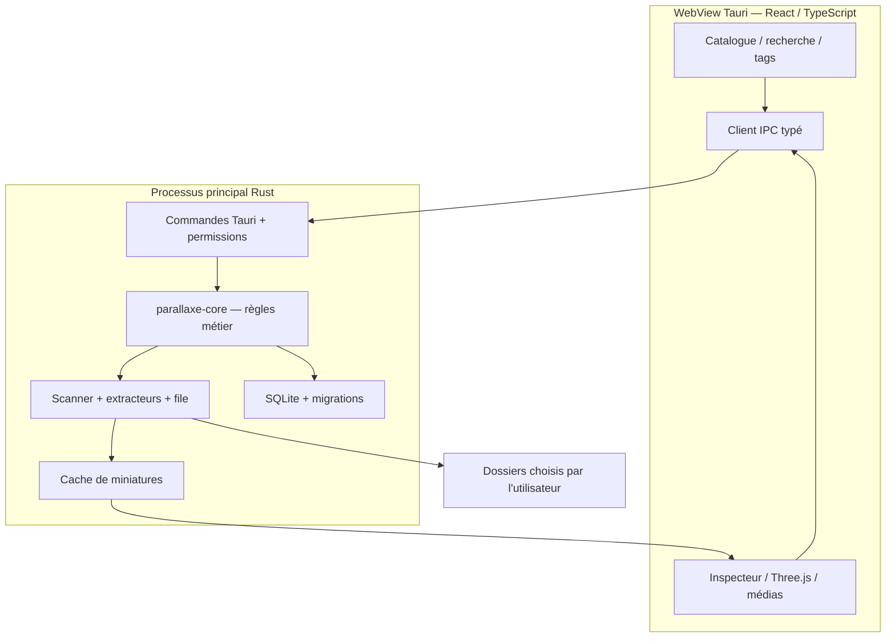

# Architecture

## Vue d'ensemble



Le frontend n'ouvre jamais de chemins arbitraires et ne touche jamais au fichier SQLite. Il appelle une interface de commandes contrôlée. Les opérations longues publient progression, fin, annulation et erreurs sans bloquer le thread UI.

## Stack

| Couche | Choix |
|---|---|
| Shell | Tauri 2 |
| Interface | React, TypeScript (strict), Vite |
| Style | Tailwind CSS, CSS classique quand c'est plus clair, Motion seulement quand une animation est justifiée |
| Cœur natif | Rust |
| Stockage | SQLite (WAL, FTS5 pour la recherche) |
| 3D | Three.js — `GLTFLoader`, `OBJLoader` + `MTLLoader`, `STLLoader` |
| Gestionnaires de paquets | pnpm, Cargo |

## Responsabilités par couche

| Couche | Fait | Ne fait pas |
|---|---|---|
| React | Navigation, rendu, saisie, états asynchrones, contrôle du viewer | Accès brut au disque, écriture directe dans SQLite |
| Client IPC TypeScript | DTO typés, erreurs, commandes Tauri | Appliquer seul les permissions métier |
| Commandes Tauri | Autorisation, validation, orchestration, canaux de progression | Décodage lourd sur le thread principal |
| `parallaxe-core` | Identités, règles de tags, transactions, cas d'usage | Dépendre de Tauri ou React |
| Indexeur | Scan, enrichissement, watcher, erreurs par fichier | Supprimer des sources ou suivre des symlinks sans règle |
| Aperçus | Miniatures, accès borné au contenu autorisé | Servir des chemins `file://` arbitraires |
| Catalogue | Persistance, recherche indexée, migrations | Écrire dans les dossiers sources |
| WebView 3D | Interaction et rendu Three.js | Exécuter des scripts fournis par des assets |

## Organisation du dépôt

Un seul monorepo ([ADR-0001](decisions/0001-monorepo.md)). Un dossier n'est créé que lorsqu'il contient du vrai code.

```text
apps/desktop/              App Tauri 2 + React
  src/                     Interface React
  src-tauri/               Shell Rust, commandes, capabilities
crates/parallaxe-core/     Règles métier, sans dépendance à Tauri
crates/…                   catalog, indexer, preview — extraits quand les frontières sont prouvées
crates/parallaxe-cli/      après le MVP
crates/parallaxe-mcp/      après le MVP
packages/shared-types/     DTO TypeScript générés depuis Rust
skills/                    Agent Skill, après le MVP
tests/fixtures/            Corpus redistribuable avec manifeste SHA-256
docs/                      Ce site
```

## Modèle de données (MVP)

| Table | Champs principaux |
|---|---|
| `libraries` | `id`, `name`, dates |
| `roots` | `id`, `library_id`, `path_native`, `status`, `last_seen_at` |
| `assets` | `id` (UUID), `library_id`, `root_id`, `path_native`, `filename`, `ext`, `kind`, `size_bytes`, `mtime`, `fs_identity?`, `status` |
| `asset_metadata` | `asset_id`, `schema_version`, `metadata_json`, `extraction_status` |
| `tags`, `asset_tags` | Tags uniques par bibliothèque (insensibles à la casse), relation N:N |
| `collections`, `collection_assets` | Groupes virtuels, relation N:N |
| `favorites` | `asset_id` |
| `previews` | `asset_id`, `content_version`, `cache_key`, `state`, `last_access` |
| `scan_jobs`, `scan_errors` | Progression, reprise et journal d'erreurs assaini |
| `asset_dependencies` | Références explicites uniquement, avec état de résolution |

La recherche utilise une table FTS5 sur le nom et le chemin. La WebView n'exécute jamais de SQL.

### Identité et chemins

- API de chemins natives (`PathBuf`, `OsString`) ; les chemins ne sont jamais supposés UTF-8.
- Chaque asset a un UUID local stable tant que la réconciliation confirme qu'il s'agit du même fichier.
- Ordre de correspondance : identité système persistante + racine → chemin existant aux propriétés concordantes → hash complet **à la demande** → décision de l'utilisateur.
- `mtime + taille` n'est jamais une preuve d'identité.
- Symlinks non suivis par défaut ; racines imbriquées normalisées pour éviter la double indexation.

### Intégrité

`foreign_keys=ON`, transactions, WAL uniquement sur systèmes de fichiers locaux, migrations versionnées et transactionnelles avec sauvegarde avant les majeures. Une migration échouée n'ouvre jamais un schéma à moitié migré en écriture. Les caches sont toujours reconstructibles et jamais l'unique copie d'une donnée métier.

## Pipeline d'indexation

1. L'utilisateur choisit un dossier dans le dialogue natif ; Rust enregistre une **racine autorisée**.
2. Les entrées sont lues en flux, jamais listées entièrement en mémoire ; profondeur, boucles et symlinks bornés.
3. `stat` plus détection par magic bytes, l'extension servant de repli.
4. Les assets génériques sont insérés par lots ; la progression est publiée régulièrement.
5. Les extracteurs tournent indépendamment du scan avec un parallélisme borné.
6. Métadonnées puis miniatures sont produites dans le cache de l'app, indexées par ID d'asset et version de contenu.
7. Un bilan final compte les fichiers indexés, non pris en charge, inaccessibles, ignorés et en erreur.
8. Les racines sont surveillées tant qu'elles sont accessibles ; événements regroupés plus rescans périodiques ou manuels, car les watchers ratent des événements.

Priorité des tâches : `user_preview` > `visible_thumbnail` > `metadata_visible` > `background_scan`.

## Métadonnées normalisées

```ts
type Confidence = 'exact' | 'estimated' | 'unavailable' | 'not_applicable';

type TechnicalValue<T> = {
  value: T | null;
  confidence: Confidence;
  unit?: string;
  method?: string;
};
```

`unavailable` n'est pas `0`. Un nuage de points a réellement zéro triangle ; un maillage illisible a un nombre inconnu.

## Commandes IPC (contrat de conception)

Les commandes prennent des IDs d'assets et de racines enregistrés, jamais des chemins libres : `library_create`, `library_list`, `library_add_root`, `scan_start`, `scan_cancel`, `assets_search`, `asset_details`, `asset_preview_handle`, `tags_*`, `collections_*`, `asset_reveal`, `cache_clear`.

Les erreurs partagent une même enveloppe :

```json
{ "code": "ASSET_UNAVAILABLE", "message": "Le fichier n'est pas accessible.", "retryable": true, "details": { "assetId": "…" } }
```

Codes : `INVALID_ARGUMENT`, `PERMISSION_DENIED`, `ROOT_OFFLINE`, `ASSET_UNAVAILABLE`, `FORMAT_UNSUPPORTED`, `DECODER_FAILED`, `RESOURCE_LIMIT`, `DATABASE_ERROR`, `SCAN_CANCELLED`, `CONFLICT`.

## CLI, MCP et plugins — après le MVP

- **CLI :** `parallaxe-cli` utilise le même cœur, sortie JSON versionnée (`--json`), codes de sortie documentés, sans interface.
- **MCP :** un adaptateur du cœur, pas une nouvelle base. Lecture seule, désactivé par défaut, transport stdio, bibliothèques, résultats et octets limités.
- **Agent Skill :** explique les workflows aux agents compatibles ; n'accorde aucun privilège.
- **Plugins :** aucune exécution de code arbitraire. D'abord des adaptateurs déclaratifs, puis un SDK à permissions après analyse des risques.

## Plateformes

| OS | Cible MVP | Points d'attention |
|---|---|---|
| macOS | Apple Silicon d'abord | WebKit, permissions de dossiers, signature et notarisation |
| Windows | x86_64 | WebView2, NTFS, chemins UNC, SmartScreen |
| Linux | x86_64 | WebKitGTK, dépendances GTK/GL, Wayland/X11, `.deb`/AppImage |
